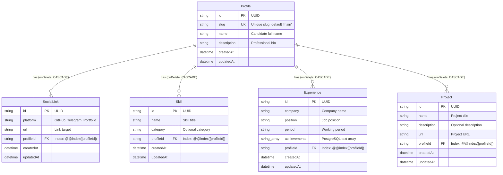

# Цифровая визитка (Digital Business Card GraphQL API)

Высокопроизводительный, строго типизированный GraphQL API цифровой визитки разработчика, реализованный на **NestJS 10**, **Prisma ORM 5**, **PostgreSQL 16** и **Docker**. Архитектура спроектирована по стандартам Enterprise-разработки: Code-First GraphQL, 3-слойная модель (Resolver -> Service -> Repository), полное решение проблемы N+1 и Overfetching через Request-Scoped **DataLoader**, транзакционный идемпотентный Seed и автоматический деплой миграций.

---

## Ссылки проекта

- **Apollo Sandbox (GraphQL Playground):** `https://<your-deployed-app-url>/graphql` *(замените на URL задеплоенного сервиса, например на Railway / Render)*
- **Healthcheck эндпоинт:** `https://<your-deployed-app-url>/health`
- **Кандидат:** Владислав Павленко
  - **GitHub:** [https://github.com/jamsen](https://github.com/jamsen)
  - **Портфолио:** [https://jamsen.vercel.app](https://jamsen.vercel.app)
  - **Telegram:** [@jamsen](https://t.me/scalemate_test_bot)

---

## Технологический стек

- **Язык и среда:** Node.js (v20+ LTS), TypeScript (строгий режим `strict: true`, `noImplicitAny: true`, `strictPropertyInitialization: true`).
- **Фреймворк:** [NestJS 10](https://nestjs.com/) (модульная архитектура, декларативный IoC / DI, `@nestjs/config`).
- **API-слой:** GraphQL Code-First (`@nestjs/graphql`, `@nestjs/apollo`, `@apollo/server` v4).
- **База данных и ORM:** PostgreSQL 16, [Prisma ORM 5](https://www.prisma.io/) (типобезопасные запросы, миграции, генерация схемы).
- **Оптимизация запросов:** [DataLoader](https://github.com/graphql/dataloader) (батчинг и изоляция кэша в рамках входящего запроса).
- **Контейнеризация:** Docker (Multi-stage сборка на базе `node:20-alpine`), Docker Compose с healthcheck PostgreSQL.

---

## Обоснование архитектурных решений

### 1. Трехслойная архитектура и разделение ответственности (Separation of Concerns)

В проекте строго соблюдается разделение ответственности на 3 независимых слоя:
```
[ Client / Apollo Sandbox ]
           │
           ▼
┌──────────────────────────────────────┐
│  Transport Layer: ProfileResolver   │
│  - Декораторы GraphQL (@Query, @ResolveField)
│  - Маршрутизация запросов к сервису и DataLoader
└──────────────────┬───────────────────┘
                   │
                   ▼
┌──────────────────────────────────────┐
│  Business Layer: ProfileService      │
│  - Доменная логика и правила
│  - Обработка исключений (NotFoundException)
└──────────────────┬───────────────────┘
                   │
                   ▼
┌──────────────────────────────────────┐
│  Data Layer: ProfileRepository       │
│  - Инкапсуляция PrismaService / SQL
│  - Строго типизированные методы доступа к БД
└──────────────────┬───────────────────┘
                   │
                   ▼
┌──────────────────────────────────────┐
│  Database: PostgreSQL 16             │
└──────────────────────────────────────┘
```

- **Resolver (`src/profile/profile.resolver.ts`):** Отвечает исключительно за GraphQL-транспорт: объявление `@Query` и `@ResolveField`, валидацию входящих типов и делегирование задач сервису или батч-лоадеру. В резолвере отсутствует бизнес-логика и прямые вызовы к БД.
- **Service (`src/profile/profile.service.ts`):** Содержит бизнес-правила (поиск профиля по умолчанию, генерация понятных доменных ошибок `NotFoundException('Profile not found...')`).
- **Repository (`src/profile/repositories/profile.repository.ts`):** Единственная точка контакта с базой данных через `PrismaService`. Сервисы и резолверы не знают о структуре Prisma-запросов. Это гарантирует возможность изолированного модульного тестирования с моками репозитория без подъема реальной базы данных.

---

### 2. Решение проблемы N+1 и Overfetching в GraphQL

#### Проблема Overfetching в традиционном подходе
Если при запросе корневого профиля сразу загружать все связи (`prisma.profile.findUnique({ include: { links: true, skills: true, experiences: true, projects: true } })`), то даже когда клиенту нужны только поля `name` и `description`, сервер выполнит тяжелые `LEFT JOIN` или 4 лишних запроса к связанным таблицам.

**Решение:** Метод `ProfileRepository.findDefaultProfile()` намеренно выполняет выборку **только скалярных полей** из таблицы `profiles`. Связанные коллекции (`links`, `skills`, `experience`, `projects`) загружаются исключительно тогда, когда клиент явно указал их в теле GraphQL-запроса.

#### Проблема N+1 и ее устранение через DataLoader
Если бы каждое вложенное поле разрешалось наивным обращением в базу (`this.prisma.skill.findMany({ where: { profileId } })`), при выборке нескольких профилей (или в сложных графах) приложение порождало бы $N+1$ запросов.

**Архитектурное решение в проекте:**
1. **Изоляция в рамках запроса (`Scope.REQUEST`):** Сервис `ProfileLoader` объявлен с декоратором `@Injectable({ scope: Scope.REQUEST })`. Это гарантирует, что кэш и очереди батчинга каждого `DataLoader` существуют исключительно во время обработки одного HTTP-запроса и уничтожаются после его завершения. Это предотвращает утечку памяти и исключает отдачу устаревших/чужих кэшированных данных между разными пользователями.
2. **Батчинг через `Map`:** Все входящие идентификаторы профилей `keys: readonly string[]` собираются планировщиком DataLoader и передаются в репозиторий в виде пакетного запроса:
   ```sql
   SELECT * FROM "skills" WHERE "profileId" IN ('id-1', 'id-2', ...);
   ```
3. Полученные записи группируются в памяти через структуру `Map<string, Entity[]>`, а результат возвращается строго в порядке входного массива ключей (`keys.map((id) => map.get(id) ?? [])`).
4. **Индексы в базе данных:** Для исключения полного сканирования таблиц (Seq Scan) в `schema.prisma` добавлены явные B-Tree индексы `@@index([profileId])` для всех дочерних таблиц (`social_links`, `skills`, `experiences`, `projects`). Выборка по `IN (...)` выполняется за логарифмическое время $O(\log N)$.

---

### 3. Выбор подхода Code-First для GraphQL

- **Единый источник истины (Single Source of Truth):** Модели (`src/profile/models/*.model.ts`) описываются классами TypeScript с декораторами `@ObjectType()` и `@Field()`. Это исключает дублирование между `.graphql`-файлами схемы и DTO-классами TypeScript, предотвращая расхождение типов во время рефакторинга.
- **Генерация схемы в оперативной памяти (`autoSchemaFile: true`):** Схема GraphQL компилируется динамически в памяти при инициализации приложения без записи файла `schema.gql` на диск. Это гарантирует надежность при деплое в Docker-контейнеры с read-only файловой системой или ephemeral-контейнеры в serverless/cloud средах (Render, AWS Fargate, Kubernetes).
- **Детерминированность (`sortSchema: true`):** Схема лексикографически упорядочивается, обеспечивая стабильность генерируемых артефактов.

---

### 4. Идемпотентная инициализация и заполнение БД (Zero-Downtime Startup)

Стартовый скрипт приложения настроен как:
```bash
npm run start:prod:init
# Команда: npx prisma migrate deploy && npx prisma db seed && node dist/main
```

1. **`prisma migrate deploy`:** Применяет проверенные SQL-миграции из папки `prisma/migrations` без интерактивных запросов к пользователю.
2. **Транзакционный сидинг (`prisma/seed.ts`):**
   - Выполняется внутри атомарной транзакции `prisma.$transaction`.
   - Ищет или создает запись кандидата по уникальному полю `slug: "vladislav-pavlenko"` через `upsert`.
   - Очищает устаревшие дочерние записи (`deleteMany({ where: { profileId: profile.id } })`).
   - Наполняет актуальные списки ссылок, навыков, опыта и проектов через `createMany`.
   - **Идемпотентность:** Повторный перезапуск контейнера или скрипта seed никогда не приведет к дублированию записей или падению по `UniqueConstraintViolation`.

---

### 5. Готовность к Production и Cloud-деплою

- **Apollo Sandbox & Introspection:** В `GraphQLModule` явно включены параметры `introspection: true` и `ApolloServerPluginLandingPageLocalDefault({ embed: true })`. Это позволяет любому ревьюеру или фронтенд-разработчику сразу открыть интерактивный GraphQL Playground в браузере даже в production-режиме.
- **Удобная маршрутизация:**
  - `GET /` автоматически выполняет `302 Redirect` на `/graphql` (Apollo Sandbox).
  - `GET /health` возвращает статус `{ "status": "ok", "timestamp": "..." }` для healthcheck-проб в Docker Compose, Kubernetes Liveness Probe или облачных балансировщиках.
- **Слушатель на `0.0.0.0`:** Приложение слушает внешний сетевой интерфейс (`0.0.0.0`) и порт `process.env.PORT ?? 3000`, что необходимо для корректного проброса трафика в контейнерах Docker, Railway, Render, Fly.io.

---

## Схема данных (ER-модель)



---

## Быстрый старт

### Вариант 1: Запуск одной командой через Docker Compose (Рекомендуемый)

Убедитесь, что у вас установлены [Docker](https://docs.docker.com/get-docker/) и [Docker Compose](https://docs.docker.com/compose/).

1. Склонируйте репозиторий и перейдите в директорию проекта:
   ```bash
   cd hh_test
   ```

2. Запустите стек сервисов:
   ```bash
   docker-compose up --build
   ```

3. Docker Compose автоматически:
   - Соберет Multi-stage образ API на Alpine Linux.
   - Поднимет контейнер PostgreSQL 16 и дождется его готовности по healthcheck (`pg_isready`).
   - Применит миграции базы данных (`prisma migrate deploy`).
   - Наполнит базу данных актуальными данными кандидата (`prisma db seed`).
   - Запустит сервер на порту `3000`.

4. Откройте в браузере:
   - **Apollo Sandbox:** [http://localhost:3000/graphql](http://localhost:3000/graphql) (или [http://localhost:3000/](http://localhost:3000/))
   - **Healthcheck:** [http://localhost:3000/health](http://localhost:3000/health)

---

### Вариант 2: Локальный запуск без Docker

Требования: Node.js 20+, локально запущенный PostgreSQL.

1. Установите зависимости:
   ```bash
   npm install
   ```

2. Создайте файл `.env` на основе примера:
   ```bash
   cp .env.example .env
   ```
   *(Укажите актуальные параметры подключения `DATABASE_URL`)*

3. Сгенерируйте клиент Prisma:
   ```bash
   npm run prisma:generate
   ```

4. Примените миграции:
   ```bash
   npm run prisma:migrate
   ```

5. Наполните базу тестовыми данными кандидата:
   ```bash
   npm run prisma:seed
   ```

6. Запустите сервер в режиме разработки:
   ```bash
   npm run start:dev
   ```

---

## Примеры GraphQL-запросов для проверки

### 1. Базовый запрос (из ТЗ)

Запрос только базовых полей и списка навыков:

```graphql
query GetProfileBasic {
  profile {
    name
    description
    skills {
      name
    }
  }
}
```

**Ожидаемый ответ:**
```json
{
  "data": {
    "profile": {
      "name": "Владислав Павленко",
      "description": "Full-Stack / Backend Developer (Node.js, TypeScript, NestJS, React, Next.js). Специализируюсь на проектировании масштабируемых REST и GraphQL API, создании Telegram Mini Apps и интеграции LLM-решений.",
      "skills": [
        { "name": "TypeScript" },
        { "name": "Node.js" },
        { "name": "NestJS" },
        { "name": "GraphQL (Apollo)" },
        { "name": "Prisma ORM" },
        { "name": "PostgreSQL" },
        { "name": "Docker" },
        { "name": "Next.js / React" },
        { "name": "REST API" },
        { "name": "LLM API Integration (OpenAI / Claude / Gemini)" }
      ]
    }
  }
}
```

---

### 2. Полный запрос со всеми полями и связями

Запрос полного графа сущностей (контакты, навыки с категориями, опыт с массивом достижений и проекты):

```graphql
query GetFullProfile {
  profile {
    id
    slug
    name
    description
    links {
      id
      platform
      url
    }
    skills {
      id
      name
      category
    }
    experience {
      id
      company
      position
      period
      achievements
    }
    projects {
      id
      name
      description
      url
    }
  }
}
```

**Ожидаемый ответ:**
```json
{
  "data": {
    "profile": {
      "id": "...",
      "slug": "vladislav-pavlenko",
      "name": "Владислав Павленко",
      "description": "Full-Stack / Backend Developer (Node.js, TypeScript, NestJS, React, Next.js). Специализируюсь на проектировании масштабируемых REST и GraphQL API, создании Telegram Mini Apps и интеграции LLM-решений.",
      "links": [
        {
          "id": "...",
          "platform": "GitHub",
          "url": "https://github.com/jamsen"
        },
        {
          "id": "...",
          "platform": "Portfolio",
          "url": "https://jamsen.vercel.app"
        },
        {
          "id": "...",
          "platform": "Telegram",
          "url": "https://t.me/scalemate_test_bot"
        }
      ],
      "skills": [
        {
          "id": "...",
          "name": "TypeScript",
          "category": "Languages & Runtimes"
        },
        {
          "id": "...",
          "name": "Node.js",
          "category": "Languages & Runtimes"
        },
        {
          "id": "...",
          "name": "NestJS",
          "category": "Backend Frameworks"
        },
        {
          "id": "...",
          "name": "GraphQL (Apollo)",
          "category": "API Architecture"
        },
        {
          "id": "...",
          "name": "Prisma ORM",
          "category": "Databases & ORM"
        },
        {
          "id": "...",
          "name": "PostgreSQL",
          "category": "Databases & ORM"
        },
        {
          "id": "...",
          "name": "Docker",
          "category": "DevOps & Containers"
        },
        {
          "id": "...",
          "name": "Next.js / React",
          "category": "Frontend"
        },
        {
          "id": "...",
          "name": "REST API",
          "category": "API Architecture"
        },
        {
          "id": "...",
          "name": "LLM API Integration (OpenAI / Claude / Gemini)",
          "category": "AI & Automation"
        }
      ],
      "experience": [
        {
          "id": "...",
          "company": "Freelance / Проектная разработка",
          "position": "Full-Stack Web Developer",
          "period": "2024 — Настоящее время",
          "achievements": [
            "Разработал и оптимизировал веб-приложение аналитики цен Omniprice Radar с интеграцией внешнего API маркетплейсов",
            "Спроектировал и запустил Telegram Mini App (Scalemate) с реактивным интерфейсом и бэкенд-логикой",
            "Внедрил автоматизацию бизнес-процессов и AI-ассистентов на базе LLM API для коммерческих клиентов"
          ]
        }
      ],
      "projects": [
        {
          "id": "...",
          "name": "Omniprice Radar",
          "description": "Веб-приложение для мониторинга и аналитики цен на базе API Wildberries",
          "url": "https://omniprice-radar.vercel.app"
        },
        {
          "id": "...",
          "name": "Scalemate TMA",
          "description": "Telegram Mini App бот и веб-интерфейс",
          "url": "https://t.me/scalemate_test_bot"
        },
        {
          "id": "...",
          "name": "Personal Portfolio",
          "description": "Интерактивное портфолио разработчика с оптимизированным рендерингом",
          "url": "https://jamsen.vercel.app"
        }
      ]
    }
  }
}
```
